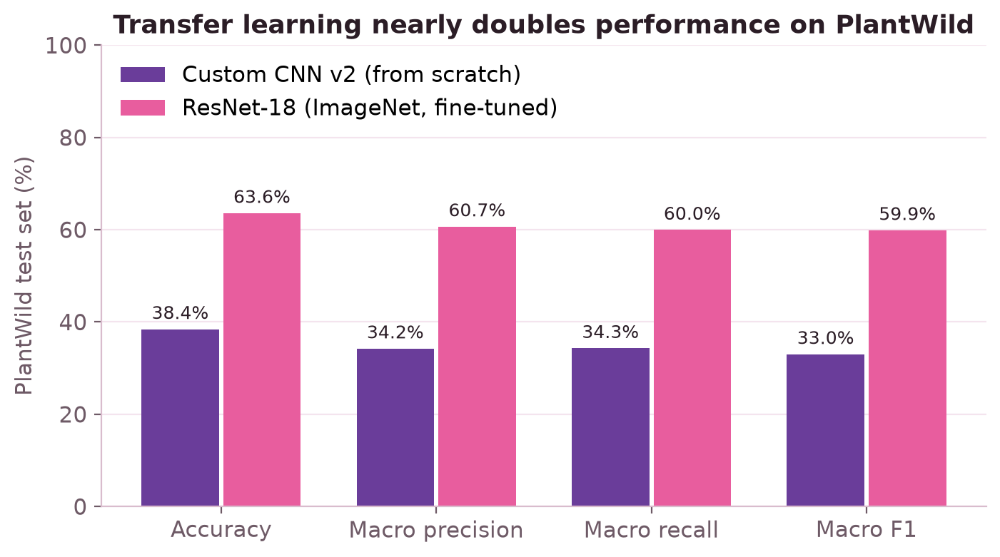
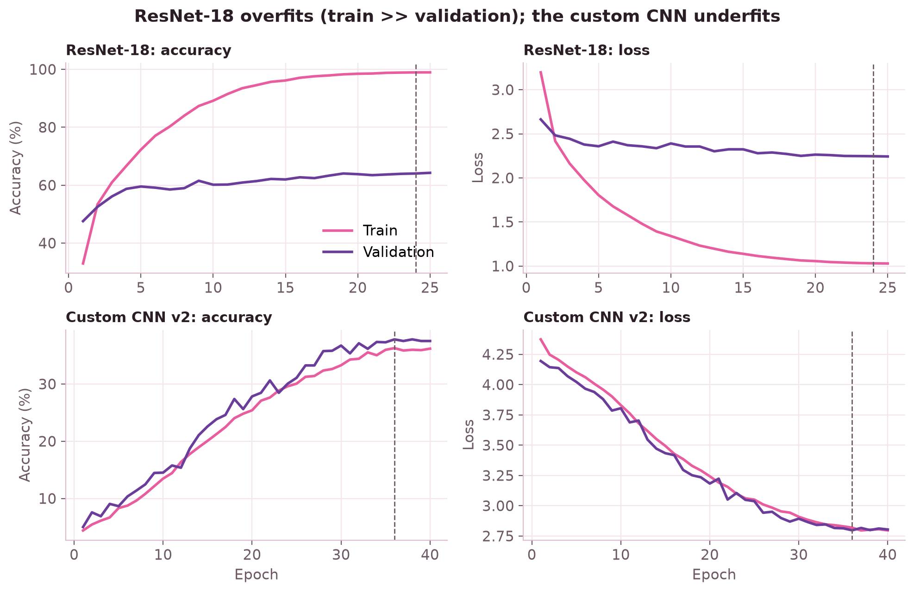
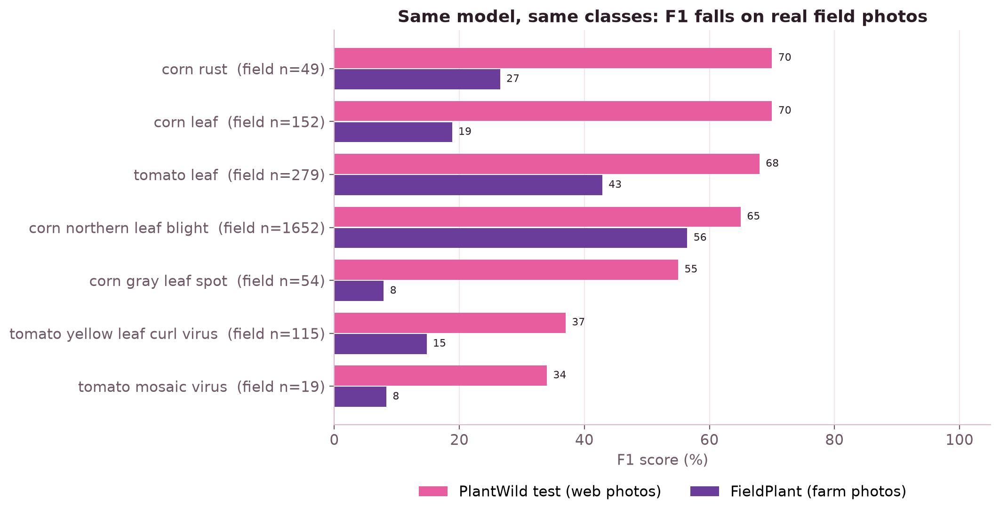
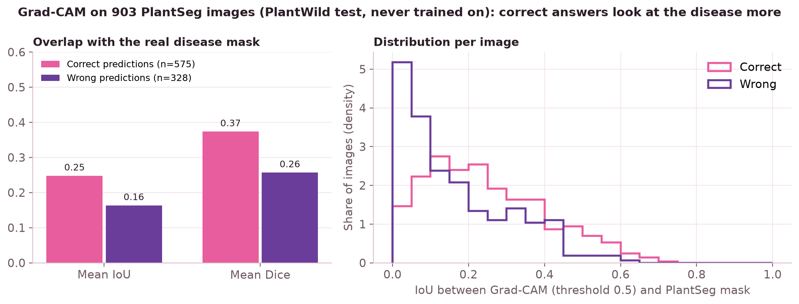
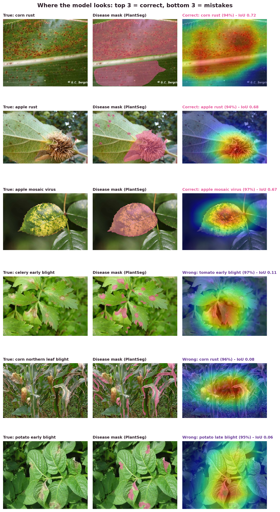

# Plant Disease Classification Using CNNs (LeafLens)

CMPE 258 Deep Learning, San Jose State University. Team: **Michelle Fang, Samantha Figueroa, Ritika Sarpal** (Group 4).

We classify in-the-wild plant photos as healthy or as one of 59 diseases (89 classes), compare a CNN trained
from scratch with a fine-tuned ResNet-18, test generalization on real farm photos, check *where* the model looks
with Grad-CAM against ground-truth disease masks, and ship the model in **LeafLens**, a Streamlit web app.

## Results at a glance

| Evaluation | Data | Result |
|---|---|---|
| Custom CNN v2 (from scratch) | PlantWild test, 3,566 images | 38.4% accuracy, 33.0% macro-F1 |
| **ResNet-18 (ImageNet, fine-tuned)** | PlantWild test, 3,566 images | **63.6% accuracy, 59.9% macro-F1** |
| Independent field test | FieldPlant, 2,320 leaf crops, 7 mapped classes | 30.3% accuracy / 0.182 macro-F1 (all 89 classes); 38.6% / 0.251 (corn/tomato classes only) |
| Grad-CAM vs. disease masks | PlantSeg, 903 images that are PlantWild test images | IoU 0.217, Dice 0.331; **correct 0.248 IoU vs. wrong 0.164** |
| Speed | ResNet-18, 11.2M parameters | 9 min training (Colab T4); ~53 ms per photo on a laptop CPU |

Key findings: transfer learning nearly doubles performance; ResNet-18 overfits while the small CNN underfits;
accuracy drops sharply on real farm photos (look-alike diseases such as corn northern leaf blight vs. gray leaf
spot); and when the model is right, its Grad-CAM heatmap overlaps the diseased tissue about 50% more than when it is wrong.

| | |
|---|---|
|  |  |
|  |  |



## Datasets

| Dataset | Role | Size |
|---|---|---|
| [PlantWild](https://huggingface.co/datasets/uqtwei2/PlantWild) | Training, validation, test (official splits) | 17,896 images after SHA-256 de-duplication; 89 classes |
| PlantSeg | Explainability: Grad-CAM vs. pixel-level disease masks | 7,774 images, 115 classes |
| FieldPlant | Independent generalization test (never trained on) | 5,156 plantation photos, 8,580 labeled leaves, 27 classes |

Datasets are not stored in the repo (size and licensing); `data/` is git-ignored and the download scripts recreate it.
**No leakage:** duplicate images were removed with SHA-256 hashes, keeping the test copy, so no test image is in training.
PlantSeg images that also appear in PlantWild train/val are excluded from the Grad-CAM evaluation; only PlantSeg
images matching PlantWild *test* images are used (the other 3,234 PlantSeg images are diseases PlantWild does not have).

## Repository layout

## Setup

Python 3.10+.

```bash
python -m venv .venv
.venv\Scripts\activate            # macOS/Linux: source .venv/bin/activate
pip install -r plant_classification_ui/requirements.txt
pip install matplotlib scikit-learn opencv-python tqdm   # for the analysis scripts
```

The tuned weights (`resnet18_tuned_best.pth`, 45 MB) are not in git. Download them from Release `v0.3-models`
(or the team Drive link) into `reports/results/resnet18_tuned/` and `plant_classification_ui/`.

## Run LeafLens

```bash
cd plant_classification_ui
python -m streamlit run Final_app.py
```

Upload or photograph a leaf to get the predicted class, the top-3 scores, and a Grad-CAM heatmap showing which
part of the photo drove the prediction. If the `.pth` is missing, the app downloads it from `LEAFLENS_MODEL_URL`
(environment variable or Streamlit secret). `python check_model.py` checks the class order and accuracy on a PlantWild test sample.

## Reproduce the evaluations (from the repo root)

```bash
python scripts/eval_fieldplant.py                 # FieldPlant: crop leaves, map classes, evaluate
python -m analysis.run_plantseg_metadata --checkpoint reports/results/resnet18_tuned/resnet18_tuned_best.pth --plantseg-root data/raw/PlantSeg/plantseg --class-names plant_classification_ui/class_names.json --overlap-csv reports/eda/plantseg/overlap_with_plantwild.csv --out reports/results/plantseg_gradcam --save-examples 12
python scripts/make_final_figures.py              # all report/slide figures + numbers.md
```

## Limitations

- Only the 89 PlantWild classes are known; any other plant is forced into the closest class.
- Performance drops on real field photos; look-alike diseases are the main source of errors.
- Grad-CAM maps are coarse (7x7), so absolute IoU with fine-grained disease masks is modest.
- LeafLens is a research prototype, not a diagnostic tool.

## Team

| Member | Main contributions |
|---|---|
| Michelle Fang | LeafLens Streamlit app and model integration; EDA review |
| Samantha Figueroa | Data pipeline and download scripts; EDA for all three datasets; de-duplication; tuned training runs; FieldPlant evaluation; final figures |
| Ritika Sarpal | Baseline CNN, ResNet-18 and custom CNN v2 models; Grad-CAM vs. PlantSeg evaluation pipeline and tests |

## References

PlantWild: Wei et al., ACM MM 2024. PlantSeg: Wei et al., arXiv:2409.04038. FieldPlant: Moupojou et al., IEEE Access 2023.
